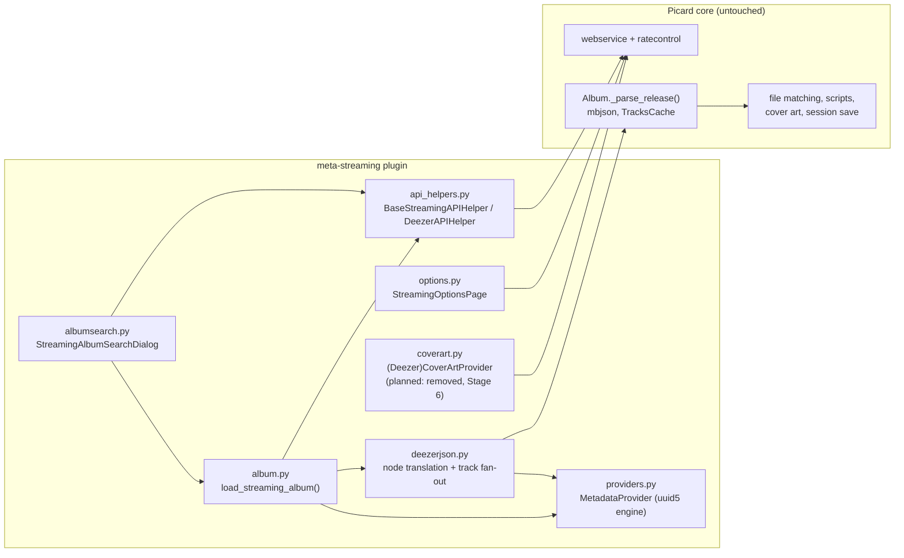

# Architecture — the Synthetic MusicBrainz Adapter

> This document explains the underlying mechanism and design ideas of the plugin. For the step-by-step runtime behavior see [dataflow.md](dataflow.md); for the ID scheme see [uuid-scheme.md](uuid-scheme.md).

## 1. The problem

MusicBrainz Picard's entire domain model is built around two things:

1. **The MusicBrainz Web Service release node** — the JSON document (`/ws/2/release/<mbid>?inc=...`) that `Album._parse_release()` (`picard/album.py`) consumes. Every downstream feature is driven from it: metadata extraction (`picard/mbjson.py`), track/file matching (TracksCache), tagger scripts, cover-art providers, session serialization.
2. **MusicBrainz IDs (MBIDs)** — UUIDs that key albums into the tagger (`tagger.albums`), group them into release groups, link tracks/recordings, and end up written to files as `musicbrainz_*` tags.

Streaming services such as Deezer have rich album metadata, but a **different JSON schema** and **different, non-UUID identifiers** (numeric Deezer IDs). A plugin cannot feed a Deezer response to Picard directly, and Picard core cannot be taught about every provider — it is not plugin-extensible at that level.

## 2. The design idea

Three possible approaches exist:

| Approach | Verdict |
| :-- | :-- |
| **A. Reimplement the album pipeline** in the plugin (own matching, own script evaluation, own cover handling) | Rejected: duplicates hundreds of lines of battle-tested core logic; every native feature (scripts, options, AcoustID, session save) would have to be re-implemented or lost. |
| **B. Extend Picard core** with a provider abstraction | Rejected: invasive, requires core changes for each new service; not achievable from a plugin. |
| **C. Translate the provider's response into the exact MusicBrainz release-node shape Picard already consumes, then hand it to Picard's own parser** | **Chosen.** The plugin is an *adapter*, not a parallel pipeline. |

Approach C is the **Synthetic MusicBrainz Adapter** pattern:

1. Fetch the album (and its tracks) from the streaming provider's API.
2. **Translate** the provider JSON into a MusicBrainz-shaped `release` node (`deezerjson.album_to_mb_release()` et al.).
3. Replace the provider's opaque IDs with **deterministic synthetic MBIDs** (`providers.MetadataProvider`).
4. Call the **same parse entry point the MusicBrainz backend uses** — `Album._parse_release(synthetic_node)` — and let Picard core do everything else natively.

The plugin never modifies Picard core, never monkey-patches it (an earlier version did; that was removed in roadmap Stage 2/3), and never invents a second metadata model. From `Album._parse_release()` onward, the album is indistinguishable from a MusicBrainz-loaded one as far as core is concerned.

## 3. What "synthetic node" must contain

The synthetic node is a *contract*: it must satisfy every hard dictionary access in Picard's parsing path. The [mapping audit](design/musicbrainz-deezer-mapping.md) verified, key by key, which of them exist and which do not. The essential ones:

| Node key | Why it is required |
| :-- | :-- |
| `release.id` | Album dict key in `tagger.albums`, `musicbrainz_albumid` tag, release-group bookkeeping, cover-art routing |
| `release.release-group.id` | Hard access `get_release_group_by_id(rg_node["id"])` in `picard/album.py`; RG cover art |
| `release.artist-credit[].artist.id` | Hard access `n["artist"]["id"]` in `artist_credit_to_metadata` (`picard/mbjson.py`) |
| `release.media[].tracks[].id` | Track matching (`musicbrainz_trackid`), TracksCache |
| `release.media[].tracks[].recording.id` | Hard access `Track(track_node["recording"]["id"], …)` in `picard/album.py` |
| `release.media[].tracks[].recording.relations = []` | **Sentinel, not dead weight.** With "use track relationships" enabled, `_needs_track_relationships()` (`picard/album.py`) returns `MISSING_TRACK_RELS` when the key is absent, which would trigger *real* MusicBrainz recording lookups that 404 on synthetic IDs. The plugin emits an empty list so the check passes and no MB request is made. |
| `release.label-info[].label.name` | `label_info_from_node()` consumes the name only (no synthetic label UUID exists — see [uuid-scheme.md](uuid-scheme.md)) |

Conversely, the audit showed which fields *look* relevant but are never consumed by core (`genres[].id`, `media[].id`, `label-info[].label.id`, `asin`, `explicit`) — those are deliberately omitted or kept minimal, so the node carries nothing without a consumer.

## 4. Component roles

| Module | Responsibility |
| :-- | :-- |
| `__init__.py` | Plugin lifecycle: `enable(api)` registers options, the cluster action, the cover-art provider (until Stage 6), the options page, dialog-state persistence, and the Deezer rate-limit floor. `disable()` cleanup is handled by the API's automatic unregistration. |
| `albumsearch.py` | `StreamingAlbumSearchDialog` (subclass of Picard's `SearchDialog`): free-text and cluster-based album search, paginated results, cached thumbnails, "Load into Picard" hand-off. |
| `album.py` | Provider-agnostic loader `load_streaming_album()`: computes synthetic UUIDs, creates/registers the `Album`, resets its state, queues the release request as an album task, moves cluster files onto it. |
| `api_helpers.py` | Transport abstraction: `BaseStreamingAPIHelper` (search / release / track / cover URL) over Picard's `APIHelper`; `DeezerAPIHelper` implementation; `_API_HELPER_REGISTRY` + `get_api_helper_for_provider()` factory. Also Deezer query-syntax helpers. |
| `deezerjson.py` | The translation layer: builds the synthetic release node from the album response, fans out per-track requests, merges track responses into `media[]`, and finishes the album through `Album._parse_release()`. Also search-result → metadata mapping. |
| `providers.py` | The ID engine: `Provider`/`EntityType` enums, pregenerated provider root UUIDs, `MetadataProvider` two-tier `uuid5` derivation. See [uuid-scheme.md](uuid-scheme.md). |
| `coverart.py` | `StreamingCoverArtProvider` / `DeezerCoverArtProvider`: queues the album's artwork URL as a typed front image. Start-disabled caveat and planned removal via the native piggyback: see [design/cover-art-piggyback-mechanism.md](design/cover-art-piggyback-mechanism.md). |
| `options.py` | `StreamingOptionsPage`: rate limit, cover size, explicit tagging. See [configuration.md](configuration.md). |

## 5. Ideas worth restating

- **Schema translation beats schema extension.** Picard's release-node format is a stable, well-tested contract; speaking it natively gives the plugin file matching, tagger scripts, release-type handling, cover art, session persistence and future core features for free.
- **Deterministic IDs beat random IDs.** Every UUID is a pure function of `(provider, entity type, provider item ID)`. The same Deezer album always produces the same MBIDs — across sessions, machines, and reinstalls — which is what makes release-group deduplication, file re-adding, and session round-trips work. See [uuid-scheme.md](uuid-scheme.md).
- **Provenance without pollution.** The synthetic node adds exactly two provider-specific tags — `deezer_album_id` (album identity for round-tripping and cover lookup) and, in search rows, `source = "Deezer"` — plus the track-level promotions handled by the track metadata processor (Stages 8–9): per-track provenance (`deezer_track_id`), the `explicit` advisory flag, and the standard `bpm` tag (when Deezer reports a value `> 0`); the Deezer genre list materializes as the multi-value `genre` tag through Picard's own genre machinery. Everything else stays inside Picard's tag mapping. Nothing else leaks into files.
- **Negative-space engineering.** As much effort went into *not* generating things: no label UUID (no consumer), no separate recording UUID (recording reuses the track node), no `asin` placeholder, no fake `cover-art-archive` key. Each omission is verified by consumer tracing in the [mapping audit](design/musicbrainz-deezer-mapping.md).
- **Concurrency inside Picard's rules.** Track details are fetched as parallel album tasks, so Picard's network queue schedules them concurrently while the plugin-configured rate-limit floor (`ratecontrol.set_minimum_delay_for_url`) keeps the provider happy. Album load time drops from sequential 15–20 s to roughly 1–2 s.
- **Honest limitations.** Synthetic MBIDs pass format validation but do not exist in MusicBrainz. The consequences (dead lookup links, one swallowed CAA 404 per load, submission hazards) are documented in [limitations.md](limitations.md), and Stage 7 of the roadmap adds an optional pre-save stripping mechanism.

## 6. Relation to the roadmap

The [roadmap](roadmap.md) records how the implementation reached this architecture:

- Stage 1: PyQt6 / API v3 migration, lifecycle alignment, no import-time side effects.
- Stage 2: parallel track fetching, rate-limit option, loader decoupling (no more `Album.load_from_deezer` monkey-patching), scalable UUID engine.
- Stage 3: options page, search UI enhancements, the multi-provider abstract layer.
- Stage 4: EAFP cleanup, explicit `api` passing, concurrency/pagination fixes.
- Stage 5: the mapping + MBID-minimization audit that validated the node contract (Section 3).
- Stage 6 (planned): replace the custom cover-art provider with the URL-relation piggyback.
- Stage 7 (planned): optional synthetic-MBID stripping before save.