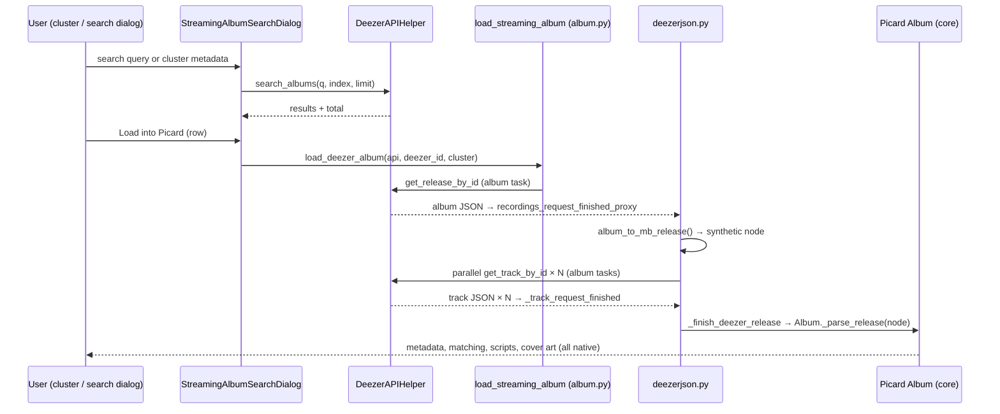

# Data Flow — From Cluster to Tagged Files

> Runtime walkthrough of the plugin's pipeline. Mechanism rationale: [architecture.md](architecture.md); endpoint details: [reference/deezer-api.md](reference/deezer-api.md).

All names below are the actual symbols in the plugin package; Picard core references are to the bundled 3.0.2 sources.

## 0. Overview

## 1. Trigger

Two entry points converge on the same dialog:

- **Cluster action** `GetMetaStreaming` (`__init__.py`, registered with `api.register_cluster_action()`): shown for clusters; builds a Deezer query from the cluster's `albumartist` + `album` metadata (`show_similar_albums()`), honoring the "Use advanced search syntax" setting.
- **Manual search**: the same `StreamingAlbumSearchDialog` free-text box.

## 2. Search

1. `DeezerAPIHelper.search_albums()` issues `GET /search/album` with `q`, `index`, `limit` (page size 25). The query is either passed through (advanced syntax) or quote-stripped (`escape_deezer_query()`); cluster queries are assembled by `build_deezer_query()` into `artist:"…" album:"…"`.
2. `handle_reply()` reads `data` and `total`; each album node is converted by `albumsearch_to_metadata()` into display metadata: `album` (title), `tracks` (`nb_tracks`), `albumartist` / `deezer_albumartist_id`, `deezer_album_id`, and `source = "Deezer"`.
3. Results render in columns Name / Artist / Tracks / Source / ID / Cover. Thumbnails (size `medium`) are fetched lazily for visible cells only and cached in a class-level `_cover_cache` keyed by Deezer album ID, so scrolling, re-sorting and pagination do not re-download.
4. **Load More** advances `index` by the page limit and re-issues the same query; the button label shows `loaded/total`. Re-searching resets state (`fetch_cleanup()` aborts pending thumbnail tasks).

## 3. Load selection

`load_selection()` → `load_deezer_album()` → the provider-agnostic `load_streaming_album(api, provider_name, album_id, cluster)` (`album.py`):

1. **Identity math** — `MetadataProvider(provider, album_id)` derives:
   - `release_mbid = uuid5(uuid5(root, "release"), album_id)`
   - `rg_mbid = uuid5(uuid5(root, "release_group"), album_id)`
   (See [uuid-scheme.md](uuid-scheme.md).)
2. **Release-group registration** — `tagger.get_release_group_by_id(rg_mbid).loaded_albums.add(release_mbid)`, so Picard groups multiple albums of the same streaming release-group.
3. **Album creation** — fetch or create `Album(release_mbid)` in `tagger.albums`, emit `album_added`.
4. **Provider stamp** — `album.metastreaming_provider = provider` (a `MetadataProvider` carrying the raw `actual_id`). This transient attribute is how later callbacks know who owns the album.
5. **Guard** — if `album.has_critical_tasks()` (a load is already in flight) the reload is skipped and the existing album returned.
6. **Reset** — `loaded = False`, status `LOADING`, release-group state cleared, metadata/genres/`_new_metadata`/`_new_tracks`/pending tasks cleared, errors cleared — mirroring what a native reload does.
7. **Request task** — `api.add_album_task(album, f"{provider}_release_{release_mbid}", …, request_factory=…, blocking=True)`; the factory calls `api_helper.get_release_by_id(album_id, partial(recordings_request_finished_proxy, api, album, task_id))` through Picard's webservice (rate-limited, priority/refresh honored).
8. **File placement** — cluster files are moved onto the new album: `tagger.move_files_to_album(cluster.files, release_mbid, album)`.

## 4. Album response → synthetic node

`recordings_request_finished_proxy()` (`deezerjson.py`) completes the release task, then:

1. `album_to_mb_release(document, provider)` builds the synthetic release node:
   - synthetic `id`, hardcoded `status: "Official"`;
   - field map `_ALBUM_TO_MB_RELEASE`: `id → deezer_album_id`, `upc → barcode`, `release_date → date`, `title → title` (empty values skipped via `mbjson._node_skip_empty_iter`);
   - `artist-credit` from `contributors` (falling back to `artist`) with computed joinphrases (`", "` between, `" & "` before the last) and synthetic artist UUIDs;
   - `label-info` with the label **name only** (no catalog number, no label UUID — core reads nothing else);
   - `genres` as `[{name, count: 1}]`;
   - `release-group` subnode with synthetic RG UUID, shared artist-credit, title, `primary-type` from `record_type` (capitalized);
   - empty `media: []` prepared for the track fan-out.
2. The node is parked on the album as the transient `album.metastreaming_mb_node`.
3. **Parallel track fan-out**: for every `document["tracks"]["data"]` entry, `_request_track()` queues a *separate album task* (`{provider}_track_{id}`, blocking) calling `GET /track/{id}`. Picard's network queue runs these concurrently, bounded by the plugin's `rate_limit_ms` floor for `api.deezer.com`. The fan-out is kept (rather than a single `GET /album/{id}/tracks`) because only the full track object carries `contributors` — accurate artist-credit for featuring tracks; see [design/track-response-analysis.md](design/track-response-analysis.md). If the album response has no track list, the release is finished immediately.

## 5. Track responses → media assembly

Each `GET /track/{id}` response lands in `_track_request_finished()`:

1. `complete_album_task()` marks the task done.
2. On error — or if the album node has vanished (e.g. the album was reset meanwhile) — the album's tasks are cancelled and the release is finished with the error.
3. `_mb_track_from_track()` converts the track JSON into a MusicBrainz-shaped **track node**:
   - synthetic `id` (uuid5 track namespace), `deezer_track_id` kept for round-tripping, `title`;
   - `length` = Deezer seconds × 1000;
   - `position` / `number` from `track_position`;
   - `artist-credit` from `contributors` (or `artist`);
   - a **`recording` sub-node copied from the track** (`dict(track)`), so it inherits the same synthetic UUID — this is why no separate recording namespace exists. The recording additionally carries `isrcs` (from `isrc`), the same artist-credit, and the `relations: []` sentinel (prevents real-MB recording lookups on synthetic IDs — see [architecture.md](architecture.md) §3);
   - `explicit` flag when `tag_explicit` is enabled (core ignores the node key; the Stage 8 processor materializes it as the regular `explicit` tag together with `deezer_track_id` provenance — see [design/explicit-tag-analysis.md](design/explicit-tag-analysis.md)).
4. The track node is slotted into `metastreaming_mb_node["media"][disk_index]["tracks"][track_index]` (0-based `disk_number - 1` / `track_position - 1`), growing the `media` list with `{"position", "format": "Digital Media", "track-count": 0, "tracks": []}` mediums and padding with empty dicts as needed; `track-count` is refreshed.
5. **Completion**: when `not album.has_critical_tasks()` — i.e. the last in-flight track task finished — `_finish_deezer_release(album, metastreaming_mb_node, …)` runs.

## 6. Finishing: hand-off to Picard core

`_finish_deezer_release(album, mb_document, http, error)`:

1. `_parse_release(mb_document)` — **the native Picard entry point** (`picard/album.py`). It stores the raw node as `_release_node` and runs the standard `mbjson` parsers, which invoke the plugin's track metadata processor per track (`run_track_metadata_processors` → `deezerjson.track_metadata_processor`): it promotes `deezer_track_id` (per-track provenance), `bpm` (standard tag, when Deezer reports `> 0`), and — when the `tag_explicit` option is enabled — `explicit = "1"` from the synthetic node into the final track metadata (see [design/explicit-tag-analysis.md](design/explicit-tag-analysis.md) and [design/track-response-analysis.md](design/track-response-analysis.md)):
   - `PARSED` → the plugin stamps `album._new_metadata[f"{provider}_albumid"] = actual_id` (provenance tag, used by cover art and session round-trips), then `_run_album_metadata_processors()`, then `_finalize_loading(error=False)`.
   - `REDIRECT` → treated as success-with-error-reset.
   - Any exception → `album.error_append(traceback)` and a failed finalize.
2. Error path (network/parse failure): `album.error_append(http.errorString())` and `_finalize_loading(error=True)`.
3. `finally`: the transient `metastreaming_provider` / `metastreaming_mb_node` attributes are removed (`_clean_attributes`) — the album ends up holding only standard Picard state plus the synthetic node in `_release_node`.

Everything after this point is **native Picard**: metadata extraction (`release_to_metadata` et al.), TracksCache file matching, tagger scripts, `~primaryreleasetype`/`releasetype` handling, cover-art processors, and session serialization of `_release_node` (so a saved session restores the synthetic album verbatim).

## 7. Failure and concurrency model

- **Album tasks are the unit of progress.** The release request and every track request are registered with `add_album_task(..., blocking=True)` and completed via `complete_album_task()`. `_finish_deezer_release` fires only when no critical tasks remain, so there is exactly one finalizer per load.
- **Race safety**: a track response arriving after the album was reset finds no `metastreaming_mb_node`, cancels remaining tasks and finishes with the error instead of writing into a stale node.
- **Rate limiting**: one global minimum delay for `https://api.deezer.com`, set from the `rate_limit_ms` option on plugin enable and on options save; search requests are marked `priority=True, important=True` so interactive searches beat background work.
- **Dialog robustness**: pending thumbnail downloads are aborted on close/re-search; parse errors in `_cover_downloaded` degrade to "not found" cells rather than crashing the dialog.