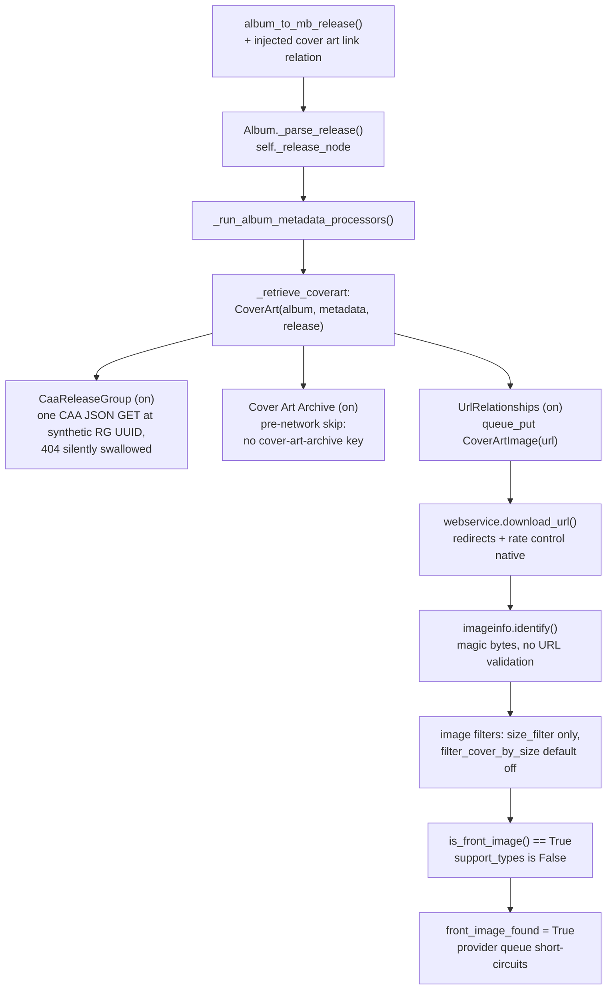

# Cover Art Delivery — Why the UrlRelationships Piggyback Works

> Design record for Stage 6 of [`roadmap.md`](../roadmap.md). The roadmap's Stage 6 describes *what* changes; this document explains *why the mechanism is sound*: how a `cover art link` URL relation injected into the plugin's synthetic release node delivers streaming artwork through Picard's native, default-enabled `UrlRelationships` cover art provider — and a gate-by-gate proof that the non-MusicBrainz image URL passes every native cover-art check.
>
> All source references are to the bundled Picard 3.0.2 sources.

## 1. Summary

Picard's cover-art pipeline never asks *where* a queued URL comes from. Every decision after queuing is made on the downloaded bytes and on `CoverArtImage` attributes, and a **type-less image is by definition a front image** (`support_types=False ⇒ is_front_image() == True`, `picard/coverart/image.py`). `UrlRelationships` (shown in Options → Cover Art as "Allowed Cover Art URLs") is default-enabled and needs exactly one thing: a `cover art link` URL relation on the raw release node — a key the plugin fully controls, because the node is synthetic. The previous custom provider (`DeezerCoverArtProvider`) started disabled (position 666, unknown to the `ca_providers` defaults) and cannot be force-enabled programmatically without writing user config; the piggyback requires neither user action nor config changes.

## 2. Why a Custom Plugin Provider Cannot Work by Default

`CoverArt._requeue()` gates every provider behind **two** conditions:

```python
instance = provider.provider_class(self)
if provider.enabled and instance.enabled():
    result = instance.queue_images()
```

- `provider.enabled` is looked up from the user's `ca_providers` setting via `cover_art_providers()` (`picard/coverart/providers/__init__.py`). The lookup is a `defaultdict` resolving any *unknown* provider name to `PInfoTuple(position=666, enabled=False)`. Plugin-registered providers are by definition unknown to `DEFAULT_CA_PROVIDERS` (`picard/const/defaults.py`: `CaaReleaseGroup` ✓, `Cover Art Archive` ✓, `UrlRelationships` ✓, `Local` ✗). Only the checkbox in Options → Cover Art can flip the flag to True.
- `instance.enabled()` (base: `not front_image_found`) may add per-class conditions, but no subclass can bypass the first gate.

The obvious "fixes" are all dead ends:

- **Write `ca_providers` from the plugin**: mutates the user's global cover-art configuration; the Cover Art options page rewrites the entire list on save; the entry survives plugin removal. Invasive side effects on a user-editable setting.
- **Cache the downloaded cover**: `CoverArt` accepts images only via `queue_put(CoverArtImage(...))` called from inside a provider's `queue_images()`; there is no external injection point.
- **Pre-flag `front_image_found`**: `_retrieve_coverart` (a registered album metadata processor, `picard/coverart/__init__.py`) constructs a fresh `CoverArt` object for every album load; there is no persistent state to flag.

Consequence: with the custom provider, artwork silently depends on a hidden, manual user action. The piggyback removes the dependency.

## 3. The Injected Relation and Its Consumers

Genuine MusicBrainz release responses carry a `relations` list because Picard asks for it (`'url-rels'` in `inc=`, `picard/album.py:954`). The synthetic node carries whatever the plugin writes in `album_to_mb_release()`, and nothing between there and the consumers re-validates relation provenance:

```json
{
    "target-type": "url",
    "type": "cover art link",
    "url": {"resource": "https://api.deezer.com/album/<id>/image?size=xl"}
}
```

There are exactly three consumers of a *release-node* `relations` key:

| Consumer | Path | Effect of the injected relation |
| :-- | :-- | :-- |
| Tag parsing | `release_to_metadata` relations branch (`picard/mbjson.py:937`, gated by `release_ars`, default `True` — `picard/options.py:523`) | **No-op.** The url dispatcher (`picard/mbjson.py:283`) acts only on `amazon asin` → `asin` and `license` → `license`; those are also the only url-relation cases exercised in `test/test_mbjson.py`. No tag is produced, nothing is polluted. |
| Cover art | `CoverArtProviderUrlRelationships.queue_images()` (`picard/coverart/providers/urlrels.py`): `match_url_relations(('cover art link', 'has_cover_art_at'), …)` over `self.release` (`picard/coverart/providers/provider.py`) | **The point of the design.** Queues `CoverArtImage(cover_url)` — type-less: `types=[]`, `support_types=False`. |
| Session export | `_release_node_cache` property (`picard/album.py:229`, gzip + `DataHash`, PICARD-2172) | The whole node — injected relation included — is serialized on session save and restored on reload, so the cover resolves identically after a session round-trip (desirable). |

> **Do not confuse** this release-level `relations` key with `media[].tracks[].recording.relations = []`, which the plugin emits so that `_needs_track_relationships()` (`picard/album.py:563`) does not return `MISSING_TRACK_RELS` and trigger real MusicBrainz recording lookups on synthetic IDs. The release-level injection does not interact with that flow.

## 4. The Node's Path to the Provider

1. `recordings_request_finished_proxy()` completes the album request and calls `album_to_mb_release(document, provider, api)` → the synthetic node now contains the injected relation.
2. `_finish_deezer_release()` calls `Album._parse_release(synthetic)` (`picard/album.py:481`) → `ParseResult.PARSED`; the raw node is stored as `self._release_node` (`picard/album.py:489`).
3. `_run_album_metadata_processors()` (`picard/album.py:475`) runs `run_album_metadata_processors(album, album._new_metadata, album._release_node)`.
4. Among those processors is `_retrieve_coverart` (`picard/coverart/__init__.py`), which constructs `CoverArt(album, metadata, release)` — providers access the raw node as `self.release`.
5. `CoverArt.retrieve()` iterates `cover_art_providers()` in `ca_providers` order (next section) — provided at least one destination is active (`save_images_to_tags` default `True`, `save_images_to_files` default `False`; if both are off, retrieval is skipped exactly as for genuine releases).



## 5. Provider Queue Walk (Default Configuration)

| # | Provider | Default | Behavior on a plugin-loaded (synthetic) album |
| :-- | :-- | :-- | :-- |
| 1 | `CaaReleaseGroup` | ✓ enabled | `enabled()` is only `not front_image_found` → runs. Fires **one** CAA JSON request at `/release-group/<synthetic RG UUID>/`; the 404 is swallowed (`ignore_json_not_found_error = True`, `picard/coverart/providers/caa_release_group.py`) — no user-visible error, one wasted request. |
| 2 | `Cover Art Archive` (release-level) | ✓ enabled | `enabled()` consults `_has_suitable_artwork` (`picard/coverart/providers/caa.py:211`): `'cover-art-archive' not in self.release` (`picard/coverart/providers/caa.py:214`) → `False` **before any network request** → silent skip. The release-level CAA provider therefore never 404s on plugin-loaded albums. |
| 3 | `UrlRelationships` | ✓ enabled | Finds the injected relation, queues the artwork URL. |
| 4 | `Local` | ✗ disabled | Skipped by default. |
| (historic) | `DeezerCoverArtProvider` | ✗ (position 666) | Skipped unless manually enabled — and even then runs **after** everything above. Removed by Stage 6. |

The concrete order and enablement always follow the user's `ca_providers` setting; the table shows defaults (`DEFAULT_CA_PROVIDERS`).

## 6. Download and Verification: Gate by Gate

Once `UrlRelationships` queues the image, the origin of the URL is irrelevant — every remaining check runs on bytes and attributes (all in `picard/coverart/__init__.py` unless noted):

1. **Queue skip rule** (`_start_queue`): type-less images are only skipped when a front image was already found — not the case when our image is dequeued.
2. **Download** (`_handle_queued_image` → `webservice.download_url()`, `picard/webservice/__init__.py:784`): performed as an album task `coverart_{id(image)}`. Redirects are handled natively; per-host rate control applies — the plugin-set minimum delay for `api.deezer.com` covers this GET, and on redirect the delay is transferred to the CDN host (`ratecontrol.copy_minimal_delay`, `picard/webservice/__init__.py:620`).
3. **Size floor** (`_coverart_downloaded`): `len(data) < 1000` → skip with a warning. Real covers are orders of magnitude larger.
4. **Identification** (`imageinfo.identify()`, `picard/util/imageinfo.py`): pure magic-byte sniffing (e.g. JPEG SOI `FF D8`); an `IdentificationError` skips the image. **There is no URL-, hostname-, or MBID-based validation anywhere in the pipeline.** Deezer serves a valid JPEG/PNG → passes.
5. **Image filters** (`_process_image_data` → `run_image_filters`, `picard/coverart/processing/__init__.py`): the only registered core filter is `size_filter` (`picard/coverart/processing/filters.py`), gated by `filter_cover_by_size` — **default `False`**. Even when enabled, the default minimum `DEFAULT_COVER_MIN_SIZE` (250×250) is far below an `xl` cover (1000×1000) → passes.
6. **Image processing** (`CoverArtImageProcessing`): resize/convert per user options — identical treatment to any CAA image.
7. **Front determination** (`_set_metadata` → `CoverArtImage.is_front_image()`): `is_front` is unset → `'front' in types`? the queued image's `types` is empty → final rule: **`support_types is False ⇒ True`**. Per the documented semantics, any image from a source that does not provide types is treated as front. Consequently `maintype` resolves to `'front'` → correct ID3 APIC type / `front` type for every file format and the correct cover-image filename; the status bar even reports the type as "Front".
8. **Queue short-circuit**: `front_image_found = True` → `_all_images_satisfied()` (default `embed_only_one_front_image=True`, `save_only_one_front_image=False`) → the provider generator returns; later providers (`Local`, and anything at position 666) are never run, and further type-less queued images are skipped.
9. **Save-time per-file filters** (`filter_image_for_file`: `bigger_previous_image_filter`, `image_types_filter`, `picard/coverart/processing/filters.py`): protective, default-inert (`dont_replace_with_smaller_cover=False`, `dont_replace_cover_of_types=False`); they only matter for files that already embed images.

**Empirical anchor:** the previous `DeezerCoverArtProvider` fetched the *same* URL (`api.deezer.com/album/<id>/image?size=xl`) through the *same* download path — and the plugin API re-exports the very same `CoverArtImage`/`CoverArtProvider` classes (`picard/plugin3/api.py`). It merely passed `types=["front"]` explicitly instead of relying on the type-less front implication. From the machinery's perspective the behavior is unchanged; only which provider queues the image differs.

## 7. Residual Behaviors and Accepted Costs

- If the user disables "Allowed Cover Art URLs", no Deezer artwork arrives — this honors an explicit user choice, identical to genuine releases.
- `CaaReleaseGroup` still issues one silently-swallowed 404 JSON request per album load (it runs before `UrlRelationships`). Eliminating it entirely would need Stage 7 MBID stripping on re-add, or a genuine release-group MBID (rejected — see next section).
- `cover_size="small"` (56×56) combined with the (default-off) "Discard small images" filter discards the cover and the queue continues — consistent with any remote-URL source; `xl` (the default) is unaffected.
- The injected `cover art link` relation never becomes a tag (inert in the url dispatcher, Section 3).

## 8. Rejected Alternatives

| Alternative | Why rejected |
| :-- | :-- |
| Write `ca_providers` from the plugin | Mutates user-editable global config; the Cover Art options page rewrites the list on save; the entry persists after plugin removal. |
| Cache the cover / pre-flag `front_image_found` | Structurally impossible: `CoverArt` accepts images only via `queue_put` inside providers, and a fresh `CoverArt` instance is built per album load. |
| Keep the custom provider, document the manual step | Remains a hidden, non-obvious requirement whose failure looks like a plugin malfunction. |
| Look up a real release-group MBID and fabricate `cover-art-archive` | Extra real-MB lookup per album; wrong-release-group mismatch risk for streaming-only releases (which are not allowed in MusicBrainz); a miss surfaces no error; still ends up fabricating nodes. |

## 9. Verification Pointers for Implementation

- **Node shape:** assert `album_to_mb_release()` output contains exactly one relation — `target-type == 'url'`, `type == 'cover art link'`, `url.resource == get_album_cover_url(...)` with the configured `cover_size`.
- **Tag purity:** re-run the Stage 5 harness (real `release_to_metadata()` with an `Option.registry`-based stub config) on the augmented node; the metadata result must be unchanged (the url dispatcher only handles `amazon asin` / `license`, neither present).
- **Front semantics:** instantiate a type-less `CoverArtImage(url)` and assert `is_front_image() is True` and `maintype == 'front'` (pure class logic, only needs `QUrl`).
- **Lint:** `ruff format` + `ruff check` on every touched plugin file.
